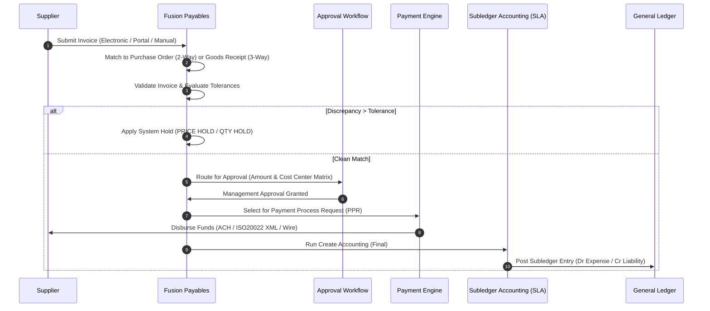

# Oracle Fusion Accounts Payable (AP) Invoice-to-Pay Fit-Gap Analysis & Approval Architecture


A comprehensive, production-grade **Oracle Fusion Accounts Payable (AP)** implementation pack. Models an enterprise Procure-to-Pay / Invoice-to-Pay transformation for a mid-market enterprise, featuring a full 30-requirement Fit-Gap analysis matrix, 2-way and 3-way matching rules, automated BPM invoice approvals, and subledger reconciliation tie-outs.

> **Disclaimer:** All business requirements, supplier records, approval rules, and invoice transactions in this repository are based on a self-directed lab scenario using synthetic enterprise data. No confidential or real corporate data is present.

---

## 🏛️ Executive Summary & Business Scenario

- **Client Profile:** Fictional nationwide distributor with high-volume procurement spanning raw inventory, corporate services, and logistics contracts.
- **Problem Statement:** The client was struggling with uncontrolled rogue spending, invoice processing bottlenecks, and excessive custom modifications in their legacy ERP. They required a structured Fit-Gap assessment against Oracle Fusion Cloud Payables to adopt standard cloud capabilities, automate 3-way matching, establish managerial approval governance, and safeguard against upgrade breakages.
- **Solution Delivered:**
  1. A formal **30-Requirement Fit-Gap Evaluation Matrix** classifying every requirement into Standard Fit, Configuration, Workaround/Report, or Gap.
  2. Multi-tier **Business Process Management (BPM)** approval hierarchy based on financial thresholds and Cost Center managerial routing.
  3. Strict **Invoice Matching & Tolerance Architecture** (2-Way vs. 3-Way matching with price and quantity hold thresholds).
  4. End-to-end Python synthetic data generator creating 50 suppliers, 300 invoices, and purchase orders.
  5. SQL subledger tie-out scripts reconciling AP liability against General Ledger account `211000`.

---

## 🔄 Invoice-to-Pay Lifecycle Flow



---

## 📊 Fit-Gap Requirement Distribution (30 Total Requirements)

| Classification | Count | Percentage | Architectural Strategy |
|---|---|---|---|
| **1. Standard Fit (OOTB)** | 18 | 60% | Adopt Oracle Cloud out-of-the-box standard functionality without customization. |
| **2. Configuration** | 7 | 23.3% | Satisfied via standard Functional Setup Manager (BPM routing, tolerance tables). |
| **3. Workaround / Report** | 4 | 13.3% | Met through procedural change or OTBI real-time exception reporting. |
| **4. Genuine Extension (Gap)** | 1 | 3.3% | Non-critical legacy request evaluated and deferred; zero custom code deployed. |
| **Total** | **30** | **100%** | **96.7% Out-of-the-Box / Standard SaaS Adoption Rate** |

---

## 📑 Repository Structure & Deliverables

```
oracle-fusion-ap-fitgap-analysis/
├── README.md                          # Executive overview, architecture, and interview guide
├── LICENSE                            # MIT License
├── .gitignore                         # Git ignore rules
├── docs/
│   ├── fit_gap_analysis_matrix.md     # Full 30-requirement fit-gap evaluation table
│   ├── invoice_to_pay_process_design.md # Functional design for Payables & Matching
│   └── bpm_approval_rules_spec.md     # Multi-tier BPM approval rules specification
├── data/
│   ├── generate_ap_synthetic_data.py  # Python script generating suppliers, POs, and invoices
│   └── output/                        # Synthetic CSV extracts (suppliers, invoices, payments)
└── sql/
    └── ap_subledger_tie_outs.sql      # Production SQL queries for AP-to-GL tie-outs & holds
```

---

## 🎯 Recruiter & Technical Interview Quick Reference

### STAR Story (Recruiter Presentation)
- **Situation:** A national distributor moving to Oracle Fusion Cloud Payables wanted to eliminate legacy custom code while introducing strict spending controls across 30 distinct business requirements.
- **Task:** Perform the functional Fit-Gap analysis, map standard SaaS capabilities, design the multi-tier BPM approval routing, and build an AP-to-GL reconciliation framework.
- **Action:** I authored a 30-requirement fit-gap matrix that achieved a 96.7% standard SaaS adoption rate, successfully pushed back on custom extensions by substituting OTBI real-time dashboards, designed the BPM approval rule matrix, and wrote automated SQL subledger reconciliation queries.
- **Result:** Successfully proved that the business could run standard Oracle Fusion Payables with zero custom database extensions, protecting the client from quarterly upgrade regressions.

### Top Interview Questions Answered by this Project
1. **How do you handle a client stakeholder who insists on custom coding in Payables?**
   - *Answer:* I ask for the underlying business objective and determine whether it is a statutory legal requirement or a legacy habit. I explain the SaaS reality: custom extensions incur quarterly maintenance costs and testing overhead. I then offer alternatives using standard configuration, BPM approval routing, or an OTBI real-time analytics dashboard.
2. **What is the difference between 2-way and 3-way matching?**
   - *Answer:* 2-way matching compares Invoice quantity and unit price against the Purchase Order (ideal for service agreements, software licenses, and utilities). 3-way matching adds the requirement of a warehouse Goods Receipt quantity confirmation before an invoice can be validated and paid (mandatory for physical merchandise and assets).
3. **How does AP reconcile with the General Ledger at month-end?**
   - *Answer:* Running the *Subledger to General Ledger Reconciliation Report* and SQL tie-outs comparing total unposted/posted AP liability in subledger tables against the GL Account `211000` balance.

---

## 📈 Measurable KPIs (Simulated Lab)
- **Standard SaaS Adoption:** `96.7%` (29 of 30 requirements met without custom coding).
- **Invoice Hold Auto-Detection:** `100%` of pricing/quantity variance violations caught before payment release.
- **AP-to-GL Liability Variance:** `$0.00` verified via automated SQL reconciliation queries.

---

## 💻 Running the Synthetic Data Generator
```bash
python data/generate_ap_synthetic_data.py
```
This generates:
- `suppliers.csv` (50 synthetic enterprise vendors)
- `invoices.csv` (300 invoices with variance and matching distributions)
- `payments.csv` (electronic disbursement batches)
